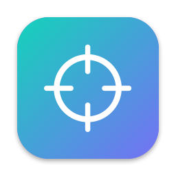
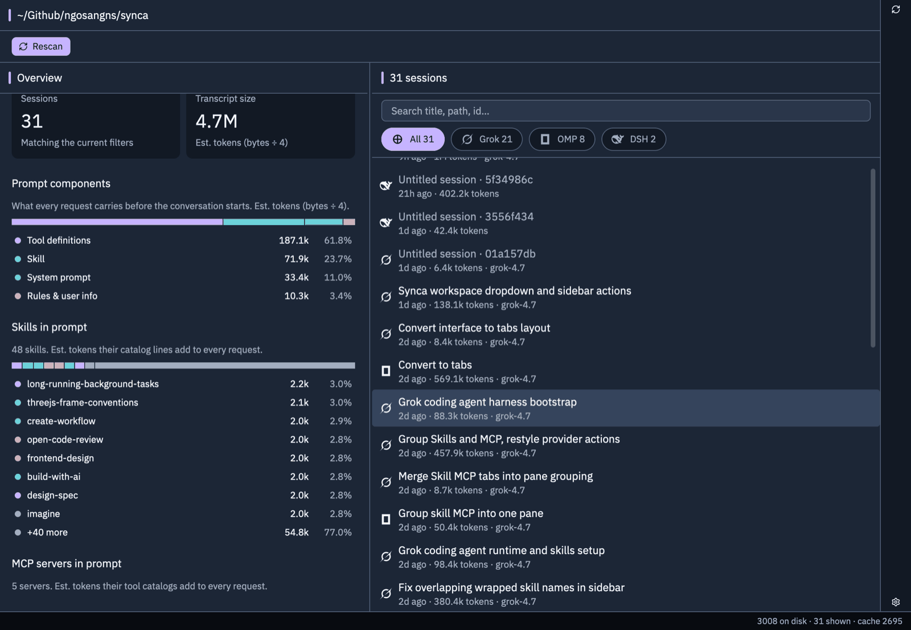
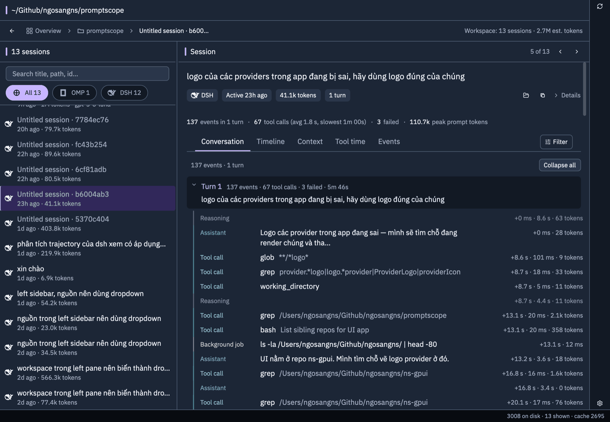
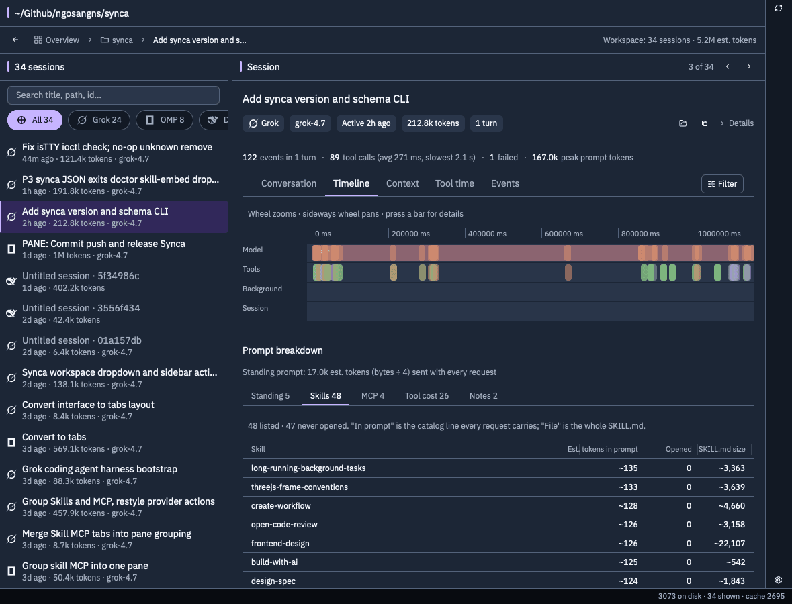
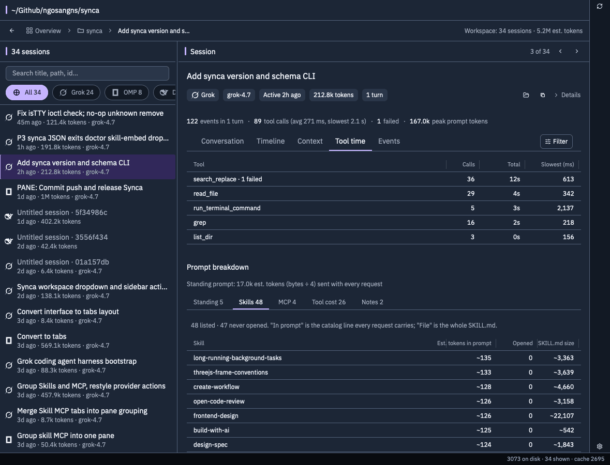
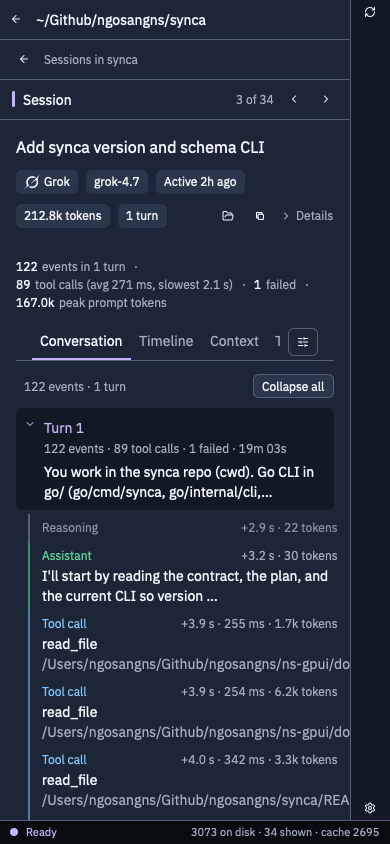

<p align="center"></p>

# Promptscope

Measures what takes up the context of your **Grok**, **Kiro**, **OMP**, **Pi**, **Devin** and **DSH** sessions on this machine.

It reads local logs. It never sends a session anywhere.

The measuring code lives in `macos/Sources/PromptscopeKit`. The CLI is `macos/Sources/promptscope-cli` (`sessions`, `scan`, `report`, `skill`, `update`). The window is `promptscope-gpui` in the sibling repo `ns-gpui`; this repo has no UI. How the layers depend on each other is described in [ARCHITECTURE.md](ARCHITECTURE.md).

## What Promptscope measures

The **standing prompt** is what the model must carry before any conversation content:

| Component | Where Grok gets it |
| --- | --- |
| System prompt | `system_prompt.txt`, split on tags that take a whole line |
| Skills | the catalog block in `chat_history.jsonl` (`skills are available`), plus the size of `SKILL.md` on disk and how many times a tool read that file |
| MCP | the server description block in the system reminder, status from `events.jsonl` |
| Rules and user info | the `<user_rules>` / `<user_info>` messages |
| Tool definitions | `tool_definitions.json` |

Individual MCP tool schemas are **not** part of the prompt. Grok loads them through `search_tool`. The MCP figure here is the server description block.

The **transcript** is the total text in the log (user, assistant, tool results, saved reasoning). Compaction can make the real context smaller than the file.

**Kiro IDE** does not record the full system prompt. The app measures steering files, the `SKILL.md` files the agent read, tool results, and `contextUsage`.

**Kiro CLI** does not store the system prompt. The app reads `context %` and the token window from the sidecar JSON, then splits prompt / assistant / tool in the `.jsonl`. CLI sessions with an empty transcript are skipped.

**Pi** (`~/.pi/agent/sessions`) records the standing prompt in the `system.sections` message: preamble, rules, project context, skill catalog, MCP, and the `toolsAdded` schema.

**OMP** (`~/.omp/agent/sessions`) uses the same JSONL format but does not store the system prompt text, only a `system-prompt-digest`. The app takes input tokens and `context %` from the usage of the last assistant turn, then counts the `SKILL.md` files that were read. A jsonl file inside the accompanying directory is a subagent.

**Devin CLI** (`~/.local/share/devin/cli/transcripts`) records system steps: identity, MCP catalog, `<available_skills>`, rules, and `tool_definitions`. `prompt_tokens` of the last agent turn is the input token count.

**DSH** (`~/.dsh/sessions`) writes one append-only log, `session.v4.jsonl`, usually compressed as `.zstd`. The standing prompt is the rendered `system/message` plus the role-tagged `user/message` rows: rules, skill catalog, runtime snapshot. The tool schema is in the latest `request/header`. `inputTokens` of the last assistant turn is the input token count. Only v4 is read. Sessions with no turns are skipped, and sessions with `delegationDepth` greater than 0 are skipped or marked as subagents.

Tokens marked `~` are `byte / 4`. That is not the model's tokenizer. For Kiro CLI, if the sidecar has a token window, that number is reported separately.

## Screenshots

The window is `promptscope-gpui` (dark theme, 1440×900). The left sidebar is cropped out of the desktop shots. They show sessions of open-source dev work on the `synca` repo.



Workspace page (`synca`), opened from the workspace list in the sidebar. Left: sessions and transcript size for the current filters, then what every request carries before the conversation starts (prompt components, skills, MCP servers), summed over the sessions in view. Right: search, source chips and the sessions of that workspace.



Session page, Conversation tab: a turn with its prompt, then reasoning, assistant text and tool calls in order, each with its offset, duration and token count.



Timeline tab: model, tool and background spans on one time axis, with the prompt breakdown (Standing, Skills, MCP, Tool cost, Notes) below.



Tool time tab: one row per tool with calls, total time and slowest call in ms, sorted by total time. Tools with failed calls show "· N failed".



The same session page in a narrow window: one pane at a time, with a back arrow to the session list.

## Download

darwin-arm64 build: <https://github.com/ngosangns/promptscope/releases/latest>

A release has three assets: `promptscope-vX.Y.Z-darwin-arm64` (the CLI), `promptscope-update-vX.Y.Z-darwin-arm64` (the updater) and `SHA256SUMS`. `task release:build` runs the tests and writes them to `dist/`. `task release:publish` publishes that release. Pushing a `v*` tag makes GitHub Actions run the same script.

The first install puts the binary at `~/.local/share/promptscope/bin/promptscope-X.Y.Z` and points `~/.local/bin/promptscope` at it. Next to it sits `promptscope-update-X.Y.Z`. After that:

```bash
promptscope update --check
promptscope update
```

`promptscope update` only replaces a symlink created by that install. It checks the GitHub `sha256` digest of both the CLI and the updater, runs `--version` on the new build, then renames the file into place. It never overwrites a running inode. It never downgrades, except `--force` when the version is equal to the current one. `--json` prints the result as JSON. The updater only supports darwin-arm64. A `swift run` build has no updater next to it and `update` fails with a message saying so.

## Build and install

Requires macOS, Swift (SwiftPM), Go and [Task](https://taskfile.dev). From the repo directory:

```bash
task test          # go vet + go test (updater), then swift test (analyzer)
task cli:install   # release CLI + updater into ~/.local/share/promptscope/bin, symlink ~/.local/bin/promptscope
task cli:build     # release CLI only, built in macos/.build
```

`task --list` lists every command. `VERSION` is the version source of truth; `cli:install` and the release script stamp it into the CLI for the build only and restore the source file.

## CLI

```
promptscope sessions list [--json] [--source S] [--since ISO|7d] [--cwd PATH] [--query TEXT] [--limit N] [--include-subagents] [--include-temporary]
promptscope sessions show <id> [--json]
promptscope scan [--json]
promptscope report <id> [--json] [--section NAME] [--summary] [--no-text] [--max-bytes N]
promptscope report grok|kiro-ide|kiro-cli|omp|pi|devin|dsh <path> [--json] [--section NAME] [--summary] [--no-text] [--max-bytes N]
promptscope skill install [--dest DIR] [--json] [--dry-run]
promptscope skill check [--dest DIR] [--json]
promptscope update [--check] [--json] [--force]
promptscope version [--json]
promptscope schema [--json] [<command>]
promptscope --version
```

`sessions list` prints one line per session, newest first: id, updated time, source, transcript bytes, cwd, title. The id is `<source>:<session>` (`grok:…`, `kiro-ide:…`, `kiro-cli:…`, `omp:…`, `pi:…`, `devin:…`, `dsh:…`). Subagents and sessions under `/tmp` or `/var/folders` are hidden unless the matching flag is set. `--query` matches title, cwd, id, model, agent, and source. It does not read transcript text. `--json` prints `{"sessions":[...]}`.

`sessions show <id>` prints that one row plus the same summary numbers as `report --summary`. A missing id exits 3.

`scan` lists how many sessions each source has and prints the notes for sources that were not found. That text is unchanged:

```
sessions 3008
  Grok 1855
  Kiro 74
  Kiro CLI 90
  ...
empty cli skipped 11409
```

`scan --json` prints `{"sessions":N,"bySource":{...},"skippedEmptyCli":N,"notes":[...]}`.

`report` measures one session and prints a plain-text report: standing prompt split by component, system prompt sections, skills, MCP servers, up to 20 tools, a one-line trajectory summary, Kiro steering files, and the context percent when the log has it. `report <id>` looks the id up. `report <source> <path>` does not: a source such as `dsh:<session>` still uses only the part before the colon, and `<path>` is the locator. The window calls that two-argument form.

`report ... --json` with no extra flags writes one object with the keys `standing`, `transcript`, `sections`, `skills`, `mcp`, `tools`, `turns`, `heavy`, `steering`, `notes`, `contextPercent`, `contextWindow`, `promptTokens`, `truncated` and `entries`. Each entry of `entries` is one trajectory event: `at`, `turn`, `kind`, `label`, `bytes`, `durationMs`, `failed`, `tokens`. The window reads this output. That shape is schema v1 and stays as it is.

`--section` (repeatable, or a comma list) returns only those keys. `--summary` returns totals: standing bytes, transcript composition bytes, estimated tokens (`standing bytes / 4`), context numbers, counts, and the top 5 heavy tool labels with byte sizes and no text. `--no-text` keeps the full shape and sets free-text fields that can hold transcript, user, or tool content to null. `--max-bytes N` shortens arrays until the document fits and sets `truncated` to true. Agents should use `--summary` or `--no-text` unless the user asked for transcript text.

`skill install` copies `skills/promptscope/SKILL.md` to `--dest` (default `~/.agents/skills/promptscope`). It mutates that directory. `--dry-run` prints the path and writes nothing. `skill check` compares the installed copy with the bytes embedded in the binary and exits 8 on drift, 3 if the directory is missing. The file in the repository is the source of truth; `scripts/embed-assets.py` regenerates the Swift constants.

`version` prints the same line as `--version`. `version --json` prints `name`, `version`, `schemaVersion` and `commit`.

`schema` prints one line per command: the path, `R` (read), `M` (mutates) or `D` (destructive), and a summary. `skill install` is `M`. `schema --json` prints a JSON Schema (draft 2020-12) for each command's JSON output. The files in `schemas/v1/` are that schema. The CLI embeds the same text. `update --json` is the updater's own object. With `--json`, an error is one `{"error":{"code","exit","message","hint"}}` object on stdout, and the process exit code is `error.exit`: 2 usage, 3 unavailable (missing file or session), 4 unparsable log, 5 failed, 8 skill drift. `skill check` on drift prints the check object, not the error envelope.

The path is the session's locator:

| Source | Path |
| --- | --- |
| Grok | `~/.grok/sessions/<encoded cwd>/<id>` (directory) |
| Kiro IDE | `~/.kiro/sessions/<workspace>/sess_<id>` |
| Kiro CLI | `~/.kiro/sessions/cli/<id>.json` (the `.jsonl` transcript sits next to it) |
| OMP | `~/.omp/agent/sessions/<cwd>/<id>.jsonl` |
| Pi | `~/.pi/agent/sessions/<cwd>/<id>.jsonl` |
| Devin | `~/.local/share/devin/cli/transcripts/<name>.json` |
| DSH | `~/.dsh/sessions/<cwd>/<id>/session.v4.jsonl.zstd` |

Without an install, from `macos/` use `swift run promptscope-cli report <source> <path>`.

Sessions under `/tmp` (and `/var/folders`) and subagents are marked as noise; the window hides them by default.

## Window

`promptscope-gpui` lives in `../ns-gpui`. It indexes the same session directories with its own Rust scanner, and runs the installed `promptscope` CLI for `report <source> <path> --json` when a session is opened and for `update --check --json` / `update`. The CLI must be installed for session pages to work. Build it from that repo:

```bash
cargo run --release -p promptscope-gpui      # run from source
task dev:install:promptscope                 # installs "Promptscope Dev.app" into ~/Applications
```

Navigation:

- **Sidebar**: Overview (all sessions, sessions by agent, prompt components, skills and MCP servers from the cache, scan notes), Replay (the library played back over 6 h, 24 h or 7 d), then one row per workspace.
- **Workspace page**: stats for the current filters, plus the session list with search and source chips (All and one per agent). Rescan is in the page header and the right rail.
- **Session page**: header (agent, last active, tokens, turns, reveal in Finder, copy, Details), previous/next session, then the tabs Conversation, Timeline, Context, Tool time and Events, with a filter for event kinds, failed events and turns. Below: Prompt breakdown with the tabs Standing, Skills, MCP, Tool cost and Notes.
- **Settings** (right rail): check for and install CLI updates, and show or hide temporary and subagent sessions.

In a narrow window the panes stack and the workspace page gets a Sessions / Overview toggle.

The window reads `~/Library/Application Support/Promptscope/digests.json` if it exists, for the skill and MCP totals in the Overview and Workspace pages. The current CLI does not write that file; without it, opening a session still gives the full report and the totals stay empty.
